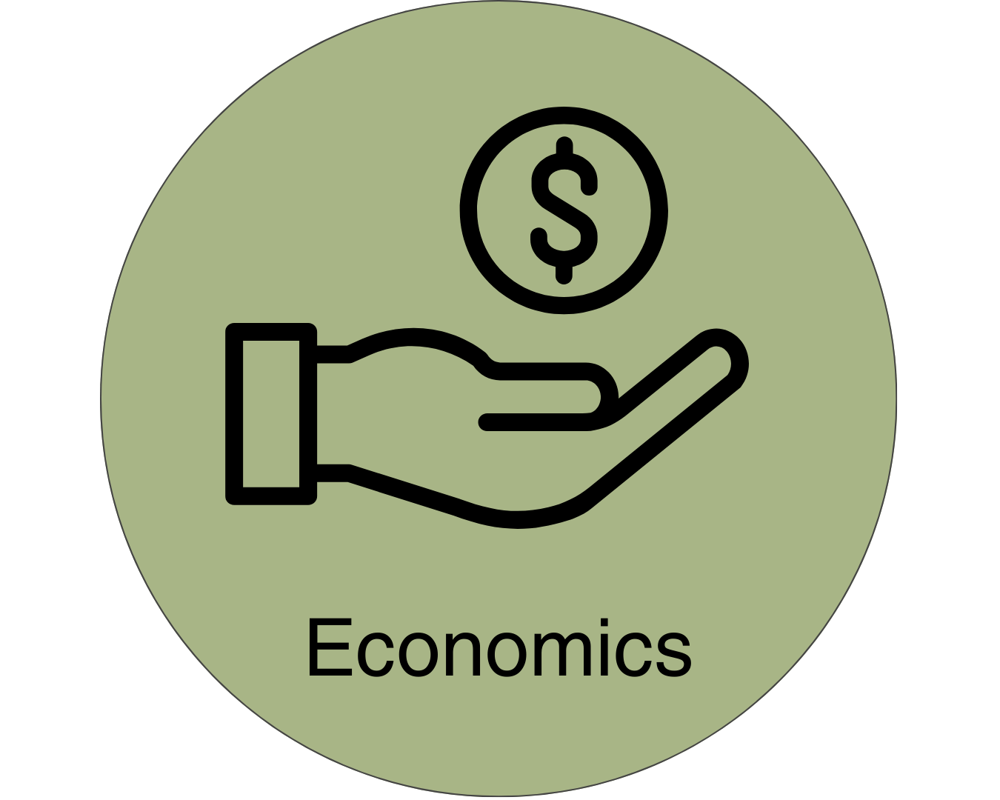
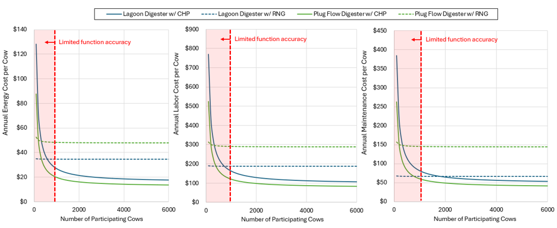

{width=25%}
# Economics Module
<!-- reuse code to import functions from "../scripts/": -->


## Introduction

The Ruminant Farm Systems (RuFaS) Economics Module is designed to be a flexible and informative tool that captures key economic tradeoffs relevant to dairy farm decision-making. While the module does support the economic evaluation of individual or combined farm practices, it is not intended to perform a full whole-farm economic assessment accounting for all capital investments, operating expenses, and revenue streams. Instead, it supports targeted evaluations of specific management or investment strategies by quantifying their impact on relevant costs, revenue streams, and return metrics. These strategies reflect real-world decisions made by dairy producers—from adjustments in feed rations and land use to investments in animal infrastructure and manure handling systems. Each practice or scenario is analyzed to understand its financial tradeoffs, risks, and potential benefits under varying production and market conditions, helping users explore the economic implications of farm-level change within a defined system boundary.

### Relevant Farm Practices and Target Analyses

**High-Quality Feed for Increased Milk Production (feed cost vs. milk price)**

This practice involves upgrading feed rations with more digestible forages, balanced nutrients, or energy-dense concentrates to improve milk output. The economics module evaluates the relationship between increased feed costs and gains in milk production, helping producers determine whether feed investments deliver sufficient returns under various herd productivity levels and milk pricing conditions.

**Land Allocation for Feed Cost Reduction (land management costs vs. feed price)**

Strategically selecting crops and allocating acreage to produce more homegrown feed, such as corn silage or alfalfa, can reduce reliance on purchased feed and enhance on-farm feed self-sufficiency. The analysis focuses on whether shifts in land allocation strategies improve economic performance by lowering feed procurement expenses while maintaining or enhancing feed quality. Land-use assumptions are set in the Crop & Soil module (total acres by crop and management practices, including any purchased or rented land). Using those acreage allocations, the Economics module then computes crop-specific input requirements and costs including seed, water, fuel, energy, tractor hours, and labor. 

**Manure Management System Investments (capital investments vs. manure product values)**

Investments in manure management infrastructure, such as anaerobic digesters, solid-liquid separators, and long-term storage systems, can unlock multiple economic and environmental benefits. These systems reduce nutrient loss and enable more efficient nutrient application, lowering fertilizer costs. Anaerobic digesters can produce renewable natural gas (RNG) or electricity through combined heat and power (CHP), generating revenue from energy sales, low-carbon fuel programs, and carbon credit markets. Additional cost savings may come from reduced hauling and off-site disposal requirements. The economics module evaluates these systems by incorporating capital and operating costs, energy and co-product revenues, and nutrient and transport savings to assess their contribution to farm profitability and sustainability.

### Flexible Economic Framework

The Flexible Economic Framework (FEF) serves as the core analytical structure of the RuFaS Economics Module. It uses a unified Discounted Cash Flow Rate of Return (DCFROR) model to evaluate the economic impacts of both individual practices and combined management strategies. Rather than relying on separate calculators for different analyses, the framework routes all analyses through a single model, adapting its assumptions and outputs based on the type of input data and user-defined scenario setup.

The FEF supports two types of economic analysis depending on whether capital investment is included in the scenario:

1.	**Partial Budget Analysis (PBA)** – used to evaluate changes in operating expenses and revenues in scenarios that do not involve capital investment.
2.	**Discounted Cash Flow Rate of Return Analysis (DCFROR)** – used when capital expenditures are included, allowing for evaluation of long-term cash flows, depreciation, and the time value of money.

Both analysis types are run through the same underlying model structure and use the same data sources and economic logic. The key difference lies in the financial assumptions and outputs: the PBA provides annual margin-based metrics, while the DCFROR generates investment metrics such as internal rate of return (IRR), payback period, and minimum product selling prices.

Importantly, both the PBA and DCFROR approaches focus on the financial impact of specific practices or investment strategies. They do not represent a comprehensive whole-farm economic analysis and should not be interpreted as reflecting all capital, operating, and revenue flows on the farm. Outputs are only valid within the boundaries of the modeled scenario and are intended to inform decisions at the practice or investment level.

### Economic Performance Metrics

The following economic metrics are used throughout the framework to characterize the financial performance of different farm configurations:

* **Internal Rate of Return (IRR)**: The discount rate at which the net present value (NPV) of all future cash flows equals zero. It reflects the expected annual rate of return on an investment and is commonly used to assess the profitability of capital-intensive projects.
* **Return on Investment (ROI)**: The ratio of net benefit to cost, expressed as a percentage. ROI measures the efficiency of an investment or practice by comparing the gains (increased revenue or cost savings) to the additional expenses required to implement it.
* **Payback Period**: The amount of time (usually in years) it takes for an investment to recover its initial cost from accumulated net cash flows (net cash flows are discounted to today’s dollars). Shorter payback periods generally indicate lower financial risk.
* **Profit Margin / Net Annual Cash Flow**: The difference between annual revenues and operating expenses. This metric provides a snapshot of profitability within a single year and is particularly relevant for partial budget analyses without capital investment.
* **Minimum Product Selling Price (MPSP)**: The minimum price at which a product (e.g., milk) must be sold for a farm practice or investment to break even over the analysis period. MPSP can be evaluated under fixed-price scenarios or using a user-defined vector of temporal price data for key commodities (e.g., energy, semen, feed). This is useful in evaluating how sensitive an investment’s viability is to market fluctuations in input costs or co-product values.

### Decision Logic and Output Routing

The model adjusts its internal logic depending on whether capital expenditures (CAPEX) are included and whether one or more scenarios are being compared:

* **Single scenario with CAPEX**: When analyzing a single farm configuration that includes capital investment, the DCFROR model incorporates the time value of money, capital depreciation, and long-term cash flow structure. Outputs from the model include net annual cash flow (profit margin), IRR, payback period, and MPSP (e.g., the lowest milk price required to break even on the specific investment or set of practices under review — not the full farm operation). 
* **Single scenario without CAPEX**: If the analysis does not include capital investment, the model performs a PBA. It focuses only on changes in operating expenses and revenues, without discounting or depreciation. In this case, the model reports profit margins or net annual cash flow as the primary output.
* **Scenario comparison with CAPEX**: When comparing two scenarios that include capital investments, the model calculates the change (delta) in key financial indicators such as IRR, payback period, or MPSP. It also reports ROI between the scenarios, providing a detailed understanding of how an investment alters financial performance.
* **Scenario comparison without CAPEX**: When comparing two farm scenarios that differ in management practices but do not involve capital investments, the DCFROR model calculates the ROI between the two. This can be done for a single year, across multiple years, or as a cumulative ROI over the entire analysis period.
* **Scenario comparison with CAPEX in only one scenario**: When only one of the two scenarios includes a capital investment, full investment metrics cannot be directly compared. In this case, the model defaults to reporting the difference in net annual cash flow between the two configurations. This provides a valid, if limited, basis for comparing the financial impact of the scenarios while avoiding misinterpretation of incompatible metrics like IRR and ROI. However, the FEF can still provide IRR, payback period, and MPSP for the scenario that does include CAPEX.

This harmonized framework allows users to conduct a wide range of economic analyses—from quick evaluations of operating tradeoffs to in-depth investment analyses—using a consistent methodology and model structure. Figure 1 illustrates the decision logic used by the FEF to determine the appropriate analysis pathway and output metrics.

{#fig-ecn-flow-fef}


## Required User Inputs

### Variable Naming Convention

To ensure consistency, traceability, and flexibility across the RuFaS Economics Module, all biophysical, economic, and non-numeric input variables follow a structured naming convention using dot notation. Each variable name reflects a hierarchical structure composed of a **variable category**, an optional **subcategory**, and an **item-level variable**, as shown below:

`[system-category_function].[subcategory].[item-level-variable]`

Biophysical inputs are grouped into four primary system categories: **animal**, **manure_mgmt**, **crop**, and **feed_storage**. Within the first element of the naming convention, the system category is followed by an underscore and a specified function, either **inputs**, **products**, or **variables**, depending on the role of the input parameter.

* **inputs** represent requirements to operate the system (e.g., fuel, labor, maintenance)
* **products** represent outputs of the system (e.g., milk, calves, RNG, carbon credits)
* **variables** represent intermediate values used in calculations or passed to other functions (e.g., dynamic costing equations)

Economic inputs are grouped into four system categories: **commodity_prices**, **farm_services**, **capital_costs**, and **cashflow_inputs**. These may be followed by sub-categories and item-level variables or may be directly followed by item-level variables.

The subcategory provides a more specific grouping within each system, often based on structured combinations such as `[crop_form]` (e.g., alfalfa_silage, alfalfa_baleage, corn_silage) or indexed variables like `[comfort_investment_i]` (where i = 1 to N distinct investments in animal comfort). This structure allows for disaggregation of costs, inputs, and outputs by specific components, forms, or investments within a broader system category—enabling more detailed and scalable analysis.

The item-level variable identifies the specific commodity, service, or output being measured or priced (e.g., `net_fertilizer_nitrogen`, `diesel`, `milk_class_2`).


### Economic Inputs

The economics module requires a set of adjustable economic inputs to quantify costs, revenues, and overall financial performance across different farm management strategies. These inputs include variables such as product prices (e.g., milk, feed, fertilizer), capital and operating costs, labor rates, and credit values (e.g., carbon offsets). To support consistent and accessible analysis, a robust set of default values is provided for all economic inputs. These defaults are based on the best available data, incorporating both temporal and geographic resolution where possible—ranging from national averages to county-level estimates, depending on data availability. While users are encouraged to modify these values to reflect site-specific conditions or local market dynamics, the default dataset allows for meaningful analysis even in the absence of detailed economic data, ensuring broad applicability and ease of use.

**Grant Financing for Capital Projects**

Many dairy sustainability projects, especially those involving anaerobic digesters or advanced manure management systems, rely on grant financing to reduce or fully offset capital expenses. Sources may include USDA’s Environmental Quality Incentives Program (EQIP), California’s Dairy Digester Research and Development Program (DDRDP), or private sustainability investment funds.

In the RuFaS Economics Module, grant contributions are modeled by adjusting the `cashflow_inputs.equity` variable, which determines the share of capital costs not financed through loans. Whether funding is secured through equity or grants, this input controls the proportion of the project’s cost base that is not subject to debt servicing, enabling flexible modeling of a wide range of financial structures.

### Binary Inputs and Booleans

The economics module includes a small set of targeted binary and Boolean inputs related to manure hauling cost calculations. These user-defined selections determine whether off-farm manure transport costs are included, whether the nutrient value of exported manure is credited in the cost-versus-revenue calculation, and whether hauling equipment is assumed to be owned or rented. While limited in number, these logic flags are important because they control how the model represents the economic boundary around off-farm manure exports. Users should adjust these inputs to accurately reflect the hauling arrangement, ownership structure, and manure valuation approach for the scenario being evaluated.

```{python}
#| label: tbl-ec-inputs-mn-hauling
#| tbl-cap: User-defined logic inputs for cost estimations of manure hauling.
import_table(
    "../resources/table_data/economics/tbl-ec-inputs-mn-hauling.csv",
    colalign=["left", "left", "center"],
)
```
The variables listed in @tbl-ec-inputs-mn-hauling represent the only binary inputs currently required for manure hauling cost estimation. These inputs allow users to define whether hauling costs and manure nutrient value are included in the economic assessment and whether hauling is modeled using owned or rented equipment. As the model evolves, additional logic inputs may be incorporated to accommodate expanded manure management configurations and alternative hauling or export arrangements.

### Biophysical Inputs

The economics module relies on a suite of biophysical inputs to quantify changes in operational costs and revenue streams. These inputs represent outputs from the RuFaS biophysical model – such as milk production, manure nutrient content, feed use, and greenhouse gas emissions – that are critical for evaluating the economic performance of farm practices. Most biophysical inputs are automatically generated within the RuFaS biophysical model, while others are currently provided through user input but are expected to be integrated into future versions of the RuFaS model. This flexible structure allows the economics module to evolve alongside improvements in system modeling, ensuring that key technical inputs remain accurate and up to date. Required biophysical input variables are listed in Table 1 and organized by target analyses. Unless otherwise specified, all biophysical input parameters are quantified and expressed on an annual basis.

## Expected Outputs

The economic module produces a variety of outputs to support user interpretation and comparison of scenarios. For DCFROR analyses, RuFaS provides a full cash flow plot across the project life and a detailed table that includes total operational costs, revenue sources, discount factors, net income by year, and NPV by year. When multiple simulations are performed, users also receive a comparison table showing either the delta between cash flow tables or selected columns from individual analyses. This helps users quickly identify which economic factors most influence profitability between scenarios.

For partial budget analyses, the system generates a ROI summary. This includes a stacked bar chart illustrating changes in costs and revenues from a baseline scenario, enabling users to visually assess which variables drive the ROI. In all cases, underlying raw data tables are provided, offering transparency into the numeric values that inform each plot and metric.


**Partial Budget Analysis**

**Example DCFROR Analysis**

This example scenario evaluates the economic feasibility of adding on-site grain storage to a mid-sized dairy farm as a strategy to reduce annual feed purchasing costs. The analysis considers the capital investment required to install two 10,000-bushel steel grain bins along with augers and electrical systems, totaling $100,000 in upfront costs. It is assumed that 80% of the capital cost is financed, reducing the initial outlay and introducing annual debt service payments into the cash flow analysis. Operating expenses—including labor, electricity, fuel, and maintenance—are estimated at $5,500 annually. The scenario assumes the farm can purchase feed in bulk at harvest prices, resulting in savings of $40 per ton compared to purchasing throughout the year, as well as reducing feed losses by 2% annually through improved storage and reduced spoilage. The investment is evaluated using the MACRS with a 7-year depreciation schedule and a target IRR of 10%. Based on these assumptions, we calculate the breakeven feed purchase price necessary for the investment to be financially justified.

In this example, we find that the maximum feed purchase price or minimum crop selling price is greater than the market feed purchase prices ($672/ton vs $280/ton), Figure 6. Therefore, it would not be financially profitable to install the feed storage equipment on the farm. Figure 5 provides a breakdown of the annual cashflows associated with this analysis. Figure 6 provides a breakdown of Minimum Product Selling Price into economic components. Figure 7 provides a breakdown of net crop emissions compared to conventional feed production emissions. Figure 8 provides a Sankey diagram breakdown of Minimum Product Selling Price into its economic components.

An Excel file containing all inputs, assumptions, and the resulting DCFROR cashflow table is supplied as Appendix B with this document. Appendix files can also be found on the Sustainability Science RuFaS GitHub repository


**Example ROI Analysis**

This example assesses the economic return of implementing a higher-cost, more nutritionally rich feed ration for a 200-cow dairy farm operating in a high milk price environment. The farm transitions from a standard feed at $0.12 per pound to a nutrient-dense option at $0.15 per pound. With each cow consuming 50 pounds of feed daily, the additional feed cost totals $109,500 annually. The improved nutrition is projected to increase milk output by 5 pounds per cow per day. Assuming a milk price of $0.40 per pound—reflecting premiums for organic, grass-fed, or value-added markets—the farm sees an annual revenue increase of $146,000. This results in a net profit gain of $36,500 per year and a ROI of 33.3%. The positive return on investment highlights the value of feed optimization when aligned with higher-margin market opportunities and reinforces the importance of integrating both production and pricing dynamics in decision-making. All the assumptions associated with this analysis are shown in Table 12 and the results are shown in Figure 9.

An Excel file containing all inputs, assumptions, and the ROI calculations is supplied as Appendix C with this document. Appendix files can also be found on the Sustainability Science RuFaS GitHub repository.


## Methodology


### Economics Module Inputs Manager

The Economics Module Inputs Manager is responsible for organizing, interpreting, and formatting all input data used within the economic analysis in RuFaS. Its primary function is to standardize data from multiple sources—user inputs, RuFaS module outputs, and default economic values—into a consistent format that can be used in partial budget and discounted cash flow analyses. All economic variables are classified based on their role in the simulation, following a naming convention that designates either costs (e.g., `*_inputs`) or revenues (e.g., `*_products`). For example, `animal_inputs` refers to costs associated with animal production, while `animal_products` includes revenue-generating outputs such as milk or replacement calves.

This classification allows the module to intelligently determine whether a given variable should be treated as a cost or a revenue source. In partial budget scenarios, this logic is extended to handle changes between baseline and alternative scenarios: reductions in revenue (e.g., lower milk output) are treated as additional costs, while reductions in cost (e.g., feed savings) are treated as effective revenues. This flexible interpretation ensures consistency in how net changes are evaluated across different scenarios and modules.

Each input to the economics module must have two components: a quantity (typically generated from the RuFaS biophysical module or specified by the user) and an associated price or cost (sourced from the RuFaS Economic Database). The Economic Inputs Manager multiplies these to calculate net costs or revenues. RuFaS-generated inputs offer the highest degree of accuracy within the current system configuration. However, if a RuFaS output is unavailable, the module can fall back to user inputs or predefined default values to ensure the analysis proceeds without interruption.

Some variables require internal conversions or pass-through calculations before they can be used in economic assessments. For instance, milk pricing may depend on fat- or protein-adjusted milk equivalents. In these cases, the Inputs Manager uses milk composition variables (e.g., percent milk fat or protein) to calculate a normalized product volume, ensuring consistent revenue estimates across scenarios with different milk quality outputs.

**Historical Data, Inflation Adjustment, and Discounting**

When historical economic data is used—particularly in DCFROR analyses—the Inputs Manager adjusts for inflation by indexing all values to a common dollar year. All historical values in the economic database are reported in nominal terms for the year they were observed (e.g., 2020 dollars for data from 2020). To ensure compatibility with DCFROR logic, the Inputs Manager deflates or inflates these values to match the starting year of the simulation. For example, if the simulation spans 2020–2024, all economic inputs will be adjusted to 2020 dollars before applying discounting using Consumer Price Index data [@blsd2023b] [@blsd2023a].

Users conducting a price volatility analysis can also provide a vector of historical price data. You can use historical data in two ways: 

1. Project historical volatility patterns into a new analysis period by restating the historical series in the analysis base year (e.g., convert a 10-year cost data series spanning 1980–1990 to 2020 dollars and then running a 10-year DCFROR beginning in the year 2020); or 
2. Run a fully historical analysis by setting the base year to the historical start (e.g., 1980), indexing all economic inputs to the base year, and supplying a price vector that begins in the base year and spans the analysis period. In this case, the Inputs Manager assumes the user has already adjusted prices to the appropriate dollar year and will require a flag indicating whether all values are in the same currency year. Failure to standardize dollar years across inputs may result in inconsistent or misleading DCFROR results, so users must ensure consistency before submitting vectors of price data to evaluate market volatility.

### Dynamic Costing Functions

The RuFaS Economics Module is designed to evaluate the financial implications of new investments or system additions on dairy farms. The physical systems changes associated with improved operational efficiency, including reduced fertilizer use, lower energy consumption, feed preservation, and the generation of new revenue streams from co-products and carbon markets, are calculated in the biophysical module. These biophysical outputs are then used as inputs to the economics module, where they are evaluated within the flexible economic framework.

The module supports a wide range of capital investment analyses, including farm-specific improvements such as animal comfort and feed storage systems. Because these investments vary greatly depending on farm design, regional practices, and individual goals, the model relies on user-defined inputs to reflect planned improvements such as new barns, ventilation systems, or advanced forage storage systems.

To support the evaluation of widely adopted and impactful manure management technologies, the module includes built-in dynamic costing functions for common solid-liquid separators and anaerobic digesters. These technologies have demonstrated strong potential to reduce manure-related GHGs [@greene2024], minimize odors, recover valuable nutrients, and generate new income through renewable energy production and participation in environmental markets.

The module provides equations for both screw press and sloped screen separators, as well as for two types of anaerobic digesters—covered lagoons and engineered plug flow systems. Each digester type can be paired with either biogas upgrading to renewable natural gas or use in combined heat and power systems for electricity generation. The costing functions estimate capital and operational costs based on herd size and capture the economies of scale that strongly influence financial feasibility.

These dynamic functions are particularly valuable for preliminary or hypothetical analyses where project-specific engineering estimates or vendor quotes may not yet be available. They enhance the model's value as a decision-support tool, allowing users to test and refine scenarios quickly and effectively.

In addition to these dynamic equations, the economics module includes placeholders for user-defined inputs across all manure management subsystems. These subsystems include manure collection, separation, long-term storage, and land application. Users can enter capital costs, labor hours, maintenance expenses, and resource use such as electricity, diesel, gasoline, propane, natural gas, and water. The module also includes built-in functions to estimate hauling costs for liquid and solid manure and provides a tool to calculate the value of off-farm manure exports based on its nitrogen, phosphorus, and potassium content.

The following sections provide detailed descriptions of the dynamic costing functions available in the RuFaS Economics Module.

**Anaerobic Digestors with Biogas Upgrading**

The RuFaS economics module includes preliminary costing functions for anaerobic digester systems based on total herd size (i.e., number of participating cows), derived from recent vendor quotes obtained from Dairy Management Inc's (DMI) U.S. Dairy Sustainability Economic Feasibility Assessment [@isley2025]. These functions estimate the fixed capital investment for the entire system including civil work, digester infrastructure, biogas upgrading equipment, installation, engineering, and permitting. Additionally, separate functions estimate operational expenses including labor, maintenance, and energy consumption (@fig-ecn-opex-ad). The equations are based on vendor quotes for representative 1,000-cow and 5,000-cow farms, with linear interpolation used to estimate costs between those points. Although interpolation is linear, the cost functions still capture the effect of economies of scale, as cost per cow declines with increasing herd size. While the equations can be applied to a wide range of herd sizes, they are most accurate for farms with between 1,000 and 5,000 cows. 

Equations are provided for both covered lagoon and plug flow digesters and for two biogas utilization pathways: biogas upgrading to produce renewable natural gas (RNG) and combined heat and power (CHP) systems for electricity generation. This results in four anaerobic digestion scenarios. For each scenario, the economics module includes four equations which can be used to estimate total capital investment and annual operating costs for energy, labor, and maintenance.These cost equations are structured as linear functions of total herd size (COWS), expressed in 2024 USD. They assume an equipment lifetime of 20 years with a salvage value of 15% of initial capital investment.

*Scenario 1: Lagoon + RNG*

$$
\text{CAPEX} = 875 \times \text{COWS} + 625,000
$$

$$
\text{ENERGY} = 34.80 \times \text{COWS} + 21
$$

$$
\text{LABOR} = 188.48 \times \text{COWS} + 113.75
$$

$$
\text{REPAIRS} = 66.69 \times \text{COWS} + 40.25
$$

*Scenario 2: Lagoon + CHP*

$$
\text{CAPEX} = 1,312.5 \times \text{COWS} + 937,500
$$

$$
\text{ENERGY} = 15.75 \times \text{COWS} + 11,250
$$

$$
\text{LABOR} = 94.5 \times \text{COWS} + 67,500
$$

$$
\text{REPAIRS} = 47.25 \times \text{COWS} + 33,750
$$

*Scenario 3: Plug Flow + RNG*

$$
\text{CAPEX} = 1,750 \times \text{COWS} + 1,000,000
$$

$$
\text{ENERGY} = 47.91 \times \text{COWS} + 445
$$

$$
\text{LABOR} = 287.47 \times \text{COWS} + 2,670
$$

$$
\text{REPAIRS} = 143.73 \times \text{COWS} + 1,335
$$

*Scenario 4: Plug Flow + CHP*

$$
\text{CAPEX} = 2,625 \times \text{COWS} + 2,000,000
$$

$$
\text{ENERGY} = 12.5 \times \text{COWS} + 7,500
$$

$$
\text{LABOR} = 75 \times \text{COWS} + 2,670
$$

$$
\text{REPAIRS} = 37.5 \times \text{COWS} + 22,500
$$

In addition to the equations for digester infrastructure and operations, the module includes a separate equation to estimate the annual cost of RNG transport and pipeline injection (2024 USD/yr), applicable to RNG scenarios:

:::{#eq-ec-B1}
[[**EC.B1**]]{.aside .content-visible when-format="html"}
$$
\text{RNG\_Transport}_{\text{OPEX}} = 137.5 \times \text{COWS}
$$
:::

Capital costs (per cow) are presented in @fig-ecn-capex-ad as a function of the total number of participating cows, also referred to as the digester population (manure_mgmt_variables.digester_population). 

{#fig-ecn-capex-ad}

Annual operational costs for energy, labor, and maintenance as a function of the number of participating cows are presented in @fig-ecn-opex-ad. 

{#fig-ecn-opex-ad}

The fitted operating cost functions in @fig-ecn-opex-ad indicate that the RNG configurations have a larger variable cost component, while the CHP configurations have a larger fixed cost component. This trend is consistent with the underlying cost structure of each pathway. In the RNG cases, a substantial portion of operating cost is tied to biogas upgrading, conditioning, compression, and related parasitic energy demand. As herd size increases, biogas production increases approximately proportionally, which means more gas must be treated and upgraded to pipeline-quality RNG. As a result, RNG labor, energy, and repair costs scale more directly with the number of cows, producing steeper variable-cost slopes. In contrast, the CHP pathway is less dependent on continuous gas-cleanup and upgrading operations. Once the digester and generator system are installed, CHP operation is comparatively less labor- and energy-intensive than RNG upgrading, and a larger share of the total OPEX is associated with baseline system oversight, routine maintenance, controls, and fixed operational requirements that do not scale as strongly with gas throughput. This produces a higher intercept and a flatter slope for the CHP cost functions.

The apparent economy of scale in OPEX is driven by the fixed-cost term in each linear function. When total annual OPEX is divided by the number of cows, the fixed component is spread across more animals as system size increases, reducing the average operating cost per cow. However, the fitted equations should not be interpreted outside the range of the vendor-quote data used to derive them. In particular, the high cost per cow observed as herd size approaches zero is a mathematical artifact of the positive intercept in the linear regression, not a physically meaningful prediction. Real systems would not be constructed or operated at very small herd sizes using the same design basis, staffing assumptions, or equipment configuration. Therefore, these functions are most appropriate for interpolation within the approximately 1,000–5,000 cow range represented by the underlying vendor quotes, and extrapolation below or above this range should be treated with caution.

**Manure Separators**

Costing functions for screw press separators were based on recent vendor quotes reported in @isley2025, while cost estimates for stationary screen separators were adapted from @UofInd. For both solid-liquid separation methods, cost components are divided into total capital investment and annual operational expenses for labor, electricity, and maintenance. All figures are calculated based on the number of cows whose manure is processed through the separator. The capital and operational costing equations for a screw presses and stationary screens are linear functions of herd size, reflecting industry observations that manure separator costs scale relatively proportionally with the number of animals and do not exhibit substantial economies of scale. This linear structure simplifies cost estimation while remaining representative of real-world cost behavior across a wide range of dairy farm sizes. 

*Screw Press [@isley2025]*

$$
\text{CAPEX} = 107.2 \times \text{COWS} 
$$

$$
\text{ENERGY} = 0.85 \times \text{COWS} 
$$

$$
\text{LABOR} = 0.54 \times \text{COWS} 
$$

$$
\text{REPAIRS} = 1.07 \times \text{COWS} 
$$

*Stationary Screen [@UofInd]*

$$
\text{CAPEX} = 61.25 \times \text{COWS} 
$$

$$
\text{ENERGY} = 0.88 \times \text{COWS} 
$$

$$
\text{LABOR} = 0.16 \times \text{COWS} 
$$

$$
\text{REPAIRS} = 0.63 \times \text{COWS} 
$$

**Estimation of Manure Hauling Costs and Manure Value**

The module supports cost estimation for both on-farm and off-farm manure hauling. For on-farm operations, the cost of hauling and land application is treated as an operational expense calculated based on the total volume of manure applied to land. Existing costing equations support the evaluation of various application methods, including broadcasting, tilling, and sub-surface injection, each with distinct operational requirements and costs. In addition to these operational costs, the benefits of on-farm manure application are also captured within the RuFaS framework. Specifically, the nutrient content of manure (nitrogen, phosphorus, and potassium) is tracked in the biophysical module and credited toward crop nutrient requirements. This reduces the need for synthetic fertilizer purchases, and the resulting cost savings are tracked in the economic module. This integration allows the economics module to account not only for the costs associated with manure handling and application but also for the financial benefits of using manure as a fertilizer substitute.

Off-farm manure transport functionality enables users to evaluate tradeoffs between manure nutrient value and transport distance. Transport costs are estimated using a component that calculates total cost based on manure mass (in tonnes) and hauling distance (in kilometers), with both fixed and variable costs expressed on a per tonne-kilometer basis. Additionally, the module includes a component to estimate the value of manure exported off-farm based on its total nitrogen, phosphorus, and potassium (NPK) content, which is tracked in the RuFaS manure module and provided as input to the economics module. Using Boolean toggles, users can choose whether to include transport costs, nutrient-based manure value, both, or neither in their analysis. Alternatively, users may manually input known net revenue or cost per tonne of manure exported, enabling full flexibility for customized economic assessments.

This modular and adaptable design allows the RuFaS Economics Module to support comprehensive techno-economic evaluation of diverse manure management strategies across a wide range of farm types, scales, and regional contexts.

*On-Farm Hauling and Land Application*

Costs associated with the hauling and on-farm land application of liquid manure were adapted from Hadrich et al. [7]. These costs are itemized into three key components: agitation and pumping from lagoon storages, hauling and land application, and incorporation via either tilling or sub-surface injection. To improve usability, the original data were simplified into two representative scenarios: a small dairy operation with 175 cows and a hauling distance of up to 2 miles, and a large dairy operation with 1,400 cows and a hauling distance of up to 4 miles [8]. Costs are reported on both a per-cow-per-year and per-gallon basis, allowing users to select the format most convenient for their analysis. A summary of these values is provided in Table 8.

The total annual operational costs for on-farm manure hauling and land application is simply the product of the variable `manure_mgmt_inputs.on_farm_manure_hauling` (gallons/yr) and the chosen value(s) from Table 7.

*On-Farm Manure Hauling (Manure Exports)*

Costing functions for the transportation of manure beyond the farm gate were adapted from Marufuzzaman et al. [9], which presents a comprehensive techno-economic analysis of wastewater sludge hauling that is transferable to solid and semi-solid manure transport. Although not specific to dairy manure, the study provides detailed cost estimates on both a per-ton and per-tonne-kilometer basis, enabling flexible and scalable evaluation of transport scenarios. The adapted functions distinguish between owned and rented equipment options, allowing users to reflect realistic operational setups. This flexibility is particularly useful when exploring regional strategies to redistribute excess manure from nutrient-surplus areas to nutrient-deficient regions, where the transport cost becomes a critical factor in feasibility. The equations also support evaluation of trade-offs between transportation distance and the nutrient value of exported manure. Cost estimates and assumptions used in the RuFaS Economics Module are summarized in Table 9.

To estimate the potential revenue from manure exports, the RuFaS Economics Module draws on nutrient content data generated by the manure module's mass balance, which tracks the flow of nitrogen (N), phosphorus (P), and potassium (K) through each stage of the manure management system. Manure value is calculated based on the bioavailable nutrient content of exported manure, using default market values of $2.76 per kilogram of bioavailable nitrogen, $1.25 per kilogram of bioavailable phosphorus, and $2.30 per kilogram of bioavailable potassium, derived from historical fertilizer price data reported by the USDA (see Table 11).

The net economic impact of off-farm manure exports, accounting for both transportation costs and nutrient value or sales revenue, is estimated using Equation 5:

	C_(manure disposal)= ∅_1 (C_fixed Α+C_variable Β)-∅_2 (2.76(N)+1.25(P)+2.30(K))	(5)

where  C_(manure disposal) (farm_services.manure_export_cost) is the annual cost (if positive) or revenue (if negative) in $/yr associated with manure exports (off-farm manure hauling), ∅_1 is the binary input (manure_mgmt_variables.include_off_farm_transport_costs), C_fixed is the fixed costs of manure hauling per tonne (from Table 8), Α is the total mass of manure exported in tonnes (manure_mgmt_products.manure_exports_tonnes from Table 1),  C_variable is the variable costs of manure hauling per tonne*km (from Table 8), Β is the total tonne*km of manure exported (manure_mgmt_products. manure_exports_tonnes * manure_mgmt_products.manure_exports_transport_distance_km), ∅_2 is the binary input (manure_mgmt_variables.include_manure_value), and N, P, and K are the total mass of manure nitrogen, phosphorus, and potassium contained in the exported manure, respectively (manure_mgmt_products.exported_manure_nitrogen, manure_mgmt_products. exported_manure_phosphorus, and manure_mgmt_products.exported_manure_potassium). 
The logic variable manure_mgmt_variables.manure_truck_ownership determines whether the fixed and variable costs from Table 8, as used in Equation 5, correspond to the owned or rented truck scenario.

**Costs Associated with the Use of Tractors**

Tractor capital and operating costs were adapted from the University of Illinois Extension’s Tractor Costs 2023 report [10] which provides detailed cost breakdowns across a wide range of tractor horsepower (HP) classes. The dataset includes list and purchase prices, hourly overhead costs, diesel consumption rates, and labor requirements per hour of tractor operation. Capital costs were indexed over multiple years using the Bureau of Labor Statistics (BLS) Producer Price Index (PPI) for farm equipment manufacturing. These were combined with county-level diesel and labor prices across multiple years to develop a spatiotemporal dataset that reflects regional and temporal variation in tractor operating costs.
Linear regression was used to derive cost equations as a function of horsepower, which were then applied to three representative tractor sizes: small (90 HP), medium (250 HP), and large (600 HP). Total hourly cost was estimated by multiplying diesel consumption by county-specific fuel prices and labor hours by county-specific wage rates. This resulted in a comprehensive per-hour cost that includes both amortized capital expenditures and all relevant operating expenses, enabling robust integration into the techno-economic analysis framework.

### Return on Investment (ROI) Calculation

The return on investment (ROI) calculation is used when a user wants to evaluate the financial merit of a specific change within a partial budget framework. This calculation is designed to estimate how much additional revenue is generated per dollar of additional cost incurred. Users typically apply the ROI tool when assessing the value of adopting a new practice or making any change that alters revenue and cost structures, without including capital investments. ROI is calculated using Equation 6. While the equation is simple, the insight it provides—expressed as a percentage return—is critical for comparing options and prioritizing changes based on their potential profitability.
	ROI=  (Increase in Revenue-Increase in Costs)/(Increase in Costs)×100%
	(6)


### Discounted Cashflow Rate of Return (DCFROR) Analysis

The DCFROR analysis is used when a user needs to evaluate the long-term financial viability of a capital investment that spans multiple years. This analysis accounts for the time value of money by calculating the net present value (NPV) of each year within a projected cash flow. By setting the NPV equal to zero, the tool identifies key financial metrics such as the IRR, payback period, or MPSP. These outputs provide essential insight into whether and when an investment becomes profitable, helping guide decisions that extend beyond a single budget year. Table 9 provides a list of all variables used to perform a DCFROR analysis and the equations thereafter are used for DCFROR calculations.

The DCFROR analysis is structured as a step-by-step process designed to evaluate the long-term financial viability of a capital investment. Each step builds upon the last, enabling the calculation of key financial metrics. The following sections describe the order of operations and the rationale for each equation used in the analysis. An example DCFROR analysis is presented in the Error! Reference source not found. section. All assumptions and results are provided in Appendix B (Excel document).

**Step 1: Define the Timeline**

The analysis begins by establishing the project timeline. If the investment includes a construction period, those years are represented as negative values. For example, a three-year construction phase would include years -2, -1, and 0. The operational phase follows, covering the full duration of the loan term (e.g., years 1 through 30). This approach ensures that pre-revenue capital costs are included in the financial evaluation. Equation 7 is used to establish the range of years used in the analysis, from the start of construction through the final year of the loan. Equation 8 provides an example of a timeline which includes a 3-year construction and at 30-year loan term. These calculations are used to populate the ‘Year’ column in Appendix B’s cash flow table.

	y=1-〖Co〗_T:L_t	(7)


	y=1-3:30= -2:30
	(8)


**Step 2: Compute Discount Factors**

To account for the time value of money, a discount factor is calculated for each year of the project timeline. This factor adjusts future cash flows to their present value, allowing financial comparisons across time. Equation 9 is used for discount factor calculation. These calculations are used to populate the ‘DiscountFactor’ column in Appendix B’s cash flow table.
		
	DF(y)=1/(1+IRR)^y 	(9)


**Step 3: Determine Capital Expenditures During Construction**

Capital expenditures are then distributed across the construction years according to a predefined construction rate. This step captures the timing and scale of capital outflows prior to the operational phase. Equation 10 determines the construction time period and Equation 11 calculates annual capital spent. These calculations are used to populate the ‘Capital’ column in Appendix B’s cash flow table.
	y= 1-〖Co〗_T:0	(10)

		
	〖CC〗_y (y)=〖Co〗_y (y)*〖CC〗_tot*E	(11)


For each year of capital spending, the portion financed through debt is calculated, Equation 12. This becomes the loan principal and forms the basis for interest and repayment calculations. These calculations are used to populate the ‘LoanPrinciple’ column in Appendix B’s cash flow table.

	L_Prin (y)=〖Co〗_y (y)*〖CC〗_tot*F	(12)


If interest accrues on the loan during construction, it is calculated using the construction interest rate and the annual loan principal, Equation 13. This cost must be included in the present value of the investment. These calculations are used to populate the ‘InterestPayment’ column in Appendix B’s cash flow table.

	L_InPay (y)=L_Prin (y)*〖IR〗_Co	(13)


The capital costs and interest payments from the construction period are converted to present value terms using the discount factors, Equation 14. This value is later subtracted from the present value of operational cash flows to determine NPV. These calculations are used to populate the ‘NPVCapitalPlusInterest’ column in Appendix B’s cash flow table.

	C_(c+i) (y)=[〖〖CC〗_y (y)+L〗_InPay (y)]*DF(y)
	(14)


**Step 4: Calculate Annual Loan Payments and Breakdown of Annual Loan Payments**

During the operational period (Equation 15), a fixed annual loan payment is computed based on the financed capital, loan interest rate, and loan term (Equation 16). This payment remains constant each year, though its composition (principal vs. interest) changes over time. These calculations are used to populate in the ‘LoanPayment’ column in Appendix B’s cash flow table.

	y= 1:L_t	(15)


	L_Pay=(〖CC〗_tot*〖IR〗_L*F)/(1-(1+〖IR〗_L )^(-L_t ) )	(16)


The loan payment is broken into interest and principal components. Early in the loan term, more of the payment goes toward interest; later, more goes toward principal. Equation 17 calculates the loan interest payments and Equation 18 calculates the annual loan principle. These calculations are used to populate the ‘InterestPayment’ and ‘LoanPrinciple’ columns, respectively, in Appendix B’s cash flow table.
	L_InPay (y)=L_Prin (y-1)*〖IR〗_L	(17)


	L_Prin (y)=L_Prin (y-1)-L_Pay+L_InPay (y)	(18)


**Step 5: Calculate Depreciation**


Annual depreciation is calculated for the capital cost using a predefined schedule using the IRS MACRS method, Equation 19 [14]. This reduces taxable income and is factored into annual cash flow calculations. The MACRS values are shown in the ‘DepreciationRate’ column in Appendix B’s cash flow table. The capital depreciation values populate the ‘CapitalDepreciation’ column in Appendix B’s cash flow table.

	D_tot (y)= D_r (y)*〖CC〗_tot	(19)


**Step 6: Determine Net Revenue and Taxable Income**

Net revenue is computed by subtracting operational costs, loan payments, and depreciation from annual revenue, Equation 20. If net revenue is negative, the value is carried forward as a tax loss along with any previous losses, Equation 21. The maximum useable losses are dictated to be 80% of the net revenue based on IRS guidelines, Equation 22 [15]. Taxable income is then adjusted accordingly using Equation 23. Losses to be carried forward are readjusted based on loss used to reduce taxable income, Equation 24. These calculations are used to populate the ‘NetRevenue’, ‘LossesForward’, and ‘TaxableIncome’ columns, respectively, in Appendix B’s cash flow table.

	R_net (y)=R(y)-C_op (y)-L_InPay (y)-D_tot (y)	(20)


	Loss(y)= Loss(y-1)+I_taxable (y-1),■(if I_taxable (y-1)<0@else Loss(y-1) ) 	(21)


	〖Loss〗_usable (y)=min(R_net (y)*0.80,abs(Loss(y))  )
(22)


	I_taxable (y)=R_net (y)-〖Loss〗_usable (y)	(23)


	Loss(y)= Loss(y)+〖Loss〗_usable (y)	(24)


**Step 7: Calculate Taxes and Annual Cash Income**

Income tax is calculated from taxable income, Equation 25. Annual cash income is then derived by subtracting the tax and loan payment from annual revenue and operation costs, Equation 26. These calculations are used to populate the ‘IncomeTax’ and ‘CashIncome’ columns, respectively, in Appendix B’s cash flow table.
	T_income (y)=I_taxable (y)*T_r	(25)


	A_income (y)= R(y)-C_op (y)-L_Pay-T_income (y)	(26)


**Step 8: Convert Annual Income to Present Value**

Each year’s cash income is discounted using the previously calculated discount factor to obtain its present value, Equation 27. These calculations are used to populate the ‘PresentValue’ column in Appendix B’s cash flow table.

	A_PV (y)= A_income (y)*DF(y)	(27)


**Step 9: Calculate Net Present Value**

Finally, the net present value of the investment is determined by summing all discounted operational cash flows and subtracting the present value of capital costs and construction interest using Equation 28. The total annual net present value is shown in the ‘NPVTotal’ column in Appendix B’s cash flow table. The net present value of tax payment, revenue, operation costs, and loan payments are shown in columns ‘NPVTax’, ‘NPVRevenue’, ‘NPVOperationCosts’, and ‘NPVLoanPayment’, respectively, in Appendix B’s cash flow table.

	NPV= ∑_(y=1)^(L_t)▒〖A_PV (y) 〗-∑_(y=1-〖Co〗_t)^0▒〖C_(c+i) (y)〗	(28)


**Goal Seek Optimization**

The DCFROR analysis tool relies on a goal-seek optimization routine to calculate one of three key financial metrics: IRR, payback time, or MPSP. After generating a NPV function by discounting the projected annual cash flows of an investment, users can explore what value of one of these variables would result in an NPV of zero. This process helps identify the conditions under which a capital investment breaks even, making it a valuable tool for evaluating the profitability and feasibility of long-term financial decisions.

Because the NPV equation is non-linear and depends on time-sensitive cash flows, it cannot be solved directly for all variables simultaneously. Users must provide values for any two of the three parameters—IRR, payback period, or MPSP—and the tool will iteratively solve for the third by adjusting its value until NPV converges to zero. For example, with an IRR and desired payback period, the tool will calculate the MPSP required to meet these targets. Alternatively, it can solve for IRR given a set MPSP and payback period, or determine the payback period based on an assumed MPSP and IRR. Users are encouraged to input target values for IRR, payback period, and MPSP, and specify the item-level variable defining the product for which MPSP is calculated. If all three are provided, the tool will perform three goal-seek operations, solving for each parameter with the other two fixed. If only two values are given, it will solve for the third. If only one is provided, the analysis cannot run.

This optimization process can be expressed generically as:

	Goal Seek: NPV(IRR,Payback Time,MPSP) = 0
(29)


In practice, the goal seek algorithm evaluates the NPV function over a range of potential values for the unknown variable and adjusts its guess iteratively. For instance, when solving for MPSP, the tool increases or decreases the price across iterations, checking whether the resulting NPV moves closer to zero, and continues adjusting until the difference is negligible. Note that payback time is often constrained to annual intervals, which can limit the granularity of the result. More precise estimates (e.g., monthly payback periods) are technically possible but require more complex implementation and time-resolution of the cash flow data.

Ultimately, this goal seek function allows users to isolate the critical financial thresholds necessary for project feasibility and supports transparent, assumption-driven capital investment planning.

A flow diagram of the DCFROR process including the goal seek optimization is shown in Figure 4.


### RuFaS Economic Database and Default Values**

**Data Retrieval Hierarchy**

To provide the most accurate and relevant results, the RuFaS Economics Module follows a structured hierarchy for data retrieval. The goal is to use the highest resolution data available for each economic variable. First, the module checks for user-supplied input values. If the user has entered a specific value for a variable, that input takes precedence. If no user input is found, the system searches for historical, spatiotemporal data corresponding to the user’s selected location—typically the county in which the analysis is performed—and for the relevant simulation years. If neither user inputs nor location-specific historical data are available, the module defaults to using national average values for the same variable and time period.

This hierarchical approach ensures that user customization is prioritized, while also enabling high-resolution, location-specific data use when available. National average data serves as a fallback, ensuring no gaps in the simulation. Most economic variables in the database are supported by at least one historical value, often sourced from the United States Department of Agriculture (USDA), covering items such as crop prices, product prices, and rates for various farm services.

**Economic Data Resolution**

Table 11 includes all economic variables used in the analysis, along with their corresponding default values and links to the CSV files containing historical data and that data’s source. The table also specifies whether each variable is supported by spatiotemporal data, limited to low-resolution sources, or represents a data gap that requires additional input. While many variables are backed by detailed historical datasets—particularly those related to crop prices, milk prices, and labor rates—others, such as feed supplements, vitamins, and minerals for cattle, are based on single-point estimates or literature values with limited resolution. For variables identified as data gaps, where neither public datasets nor internal expertise are sufficient, RuFaS relies on user input to fill in these values.

All CSV files and the associated data dictionary describing the CSV files can be found in the “_RuFaS Input Files” on the Sustainability Science RuFaS GitHub repository. 


## References