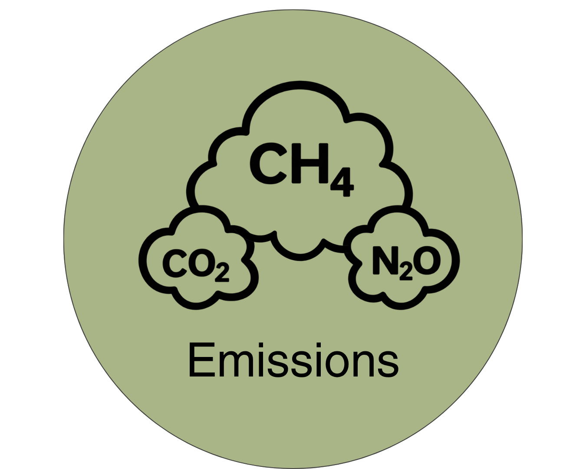

{width=25%}
# Emissions Module
<!-- reuse code to import functions from "../scripts/": -->



## Introduction

Throughout the 4 biophysical modules, emissions are estimated and reported directly from the methods within those modules and thus described within the appropriate sections of this documentation. Some emissions estimates are the results of upstream emissions created during the production of items purchased by the farm or are the result of an aggregation and allocation of emissions from a variety of sources. The methodology for those emissions that are not directly described in the biophysical modules are described in this section. The two relevant emissions methods currently represented in RuFaS are for two distinct methods to estimate emissions associated with the production of feed that is fed to animals:

1. The **Purchased Feed Emissions** methodology assigns an aggregated emissions factor to each purchased feed with an available emissions factor
2. The **Homegrown Feed Emissions** methodology allocates direct emissions from the field as well as fertilizer and manure nutrient applications to each crop harvested, stored, and fed to animals. 

The emissions and resource used associated with feeds are calculated by the `EmissionsEstimator` class in `emissions.py` and reported on a daily basis for each feed based on the amount of each feed fed to the herd that day. 

## Purchased Feed Emissions

### Calculation of Purchased Feed Emissions

Purchased feed emissions are calculated multiplying the emission factor associated with feed $i$ ($\text{EF}_{i}$) by the total dry matter mass of the feed fed to the herd each day ($\text{DM_Fed}_{i}$). 


:::{#eq-em-pfe-1}

[[**EM.PFE.1**]]{.aside .content-visible when-format="html"}    
$$
\text{PurchasedFeedEmission}_{i} = \text{EF}_{i} \times \text{DM_Fed}_{i}
$$
:::

In [EM.PFE.1](#eq-em-pfe-1), the emission factors are expected to be in units of $\text{CO}_{2}\text{-eq} / \text{kg feed DM}$. These emissions factors are provided via a database that contains an emission factor for each RuFaS Feed ID for each US FIPS county code. One set of emissions factors describes the total emissions associated with production of the feed, and the other database separates only the emissions associated with land use change. 


### Purchased Feed Emission Factor Database Preparation

The RuFaS model requires a standardized table of emission factors (EF) for all (or as many as possible) of the feeds available in the feed library. These emission factors are expressed in $\text{kg CO}_\text{2}\text{e}/\text{kg}$ feed Dry Matter (DM). Preparing this table involves consolidating data from national, regional, and county-specific sources into a unified county-level format compatible with RuFaS.

#### Data Sources and Initial Processing

The methodology draws on three distinct levels of data, each requiring specific conversions to reach the target units ($\text{kg CO}_\text{2}\text{e}/\text{kg}$ DM), summarized in @tbl-emis-pfe-sources.

```{python}
#| label: tbl-emis-pfe-sources
#| tbl-cap: Data sources used to construct the purchased feed emission factor database.
import_table(
  "../resources/table_data/emissions/tbl-emis-pfe-sources.csv",
  colalign = ["left", "left", "left", "left", "left"]
)
```

The first data processing step is to convert all emission factors into the common unit of $\text{kg CO}_\text{2}\text{-eq}/\text{kg}$ DM. Regional emission factors, originally reported on a tonne basis, are first converted to a kilogram basis:

:::{#eq-em-pfe-2}
[[**EM.PFE.2**]]{.aside .content-visible when-format="html"}    
$$
\text{EF}_\text{i}^\text{as fed, kg} = \frac{\text{EF}_\text{i}^\text{as fed, tonne}}{1000}
$$
:::

All as-fed emission factors (FoodS3, Regional, and National) are then converted to a dry matter basis using the feed's percent dry matter:

:::{#eq-em-pfe-3}
[[**EM.PFE.3**]]{.aside .content-visible when-format="html"}    
$$
\text{EF}_\text{i}^\text{DM} = \frac{\text{EF}_\text{i}^\text{as fed}}{\text{DM}_\text{i}}
$$
:::

* EF<sub>i</sub><sup>DM</sup>: emission factor of feed i, expressed on a dry matter basis (kg CO<sub>2</sub>e/kg DM)
* EF<sub>i</sub><sup>as fed</sup>: emission factor of feed i, expressed on an as-fed basis (kg CO<sub>2</sub>e/kg as fed)
* DM<sub>i</sub>: fraction of feed i's fresh mass that is dry matter

The percent dry matter assumptions used for this conversion are given in @tbl-emis-pfe-dm-content.

```{python}
#| label: tbl-emis-pfe-dm-content
#| tbl-cap: Percent dry matter assumptions used to convert as-fed emission factors to a dry matter basis.
import_table(
  "../resources/table_data/emissions/tbl-emis-pfe-dm-content.csv",
  colalign = ["left", "center"]
)
```

#### Feed Emission Factors for the RuFaS Feed Library

The RuFaS feed library contains multiple feeds that are distinct from a ruminant nutrition perspective (e.g., forages of varying maturity or feeds with slightly different compositions) but are not differentiated in the methods used to develop the feed emission factors. Available emission factors are therefore extrapolated to cover as many of the RuFaS feeds as possible. @tbl-emis-pfe-feed-id-xwalk cross-references emission factor feed names with the RuFaS Feed IDs that use that feed's emission factor.

```{python}
#| label: tbl-emis-pfe-feed-id-xwalk
#| tbl-cap: Cross-reference between emission factor feed names and RuFaS Feed IDs.
import_table(
  "../resources/table_data/emissions/tbl-emis-pfe-feed-id-xwalk.csv",
  colalign = ["left", "left"]
)
```

The RuFaS feed library also includes four byproduct mixes that represent average regional byproduct feeding rates, as described in a survey and analysis of byproduct feeding [@deondarza2021]. Emission factors for these mixed feeds are calculated by multiplying each component feed's inclusion rate by its emission factor:

:::{#eq-em-pfe-4}
[[**EM.PFE.4**]]{.aside .content-visible when-format="html"}    
$$
\text{EF}_\text{mix} = \sum_{\text{i}=1}^{n} \text{IncRate}_\text{i} \times \text{EF}_\text{i}
$$
:::

* EF<sub>mix</sub>: emission factor of the byproduct mix (kg CO<sub>2</sub>e/kg DM)
* IncRate<sub>i</sub>: inclusion rate of component feed i in the byproduct mix
* EF<sub>i</sub>: emission factor of component feed i (kg CO<sub>2</sub>e/kg DM)
* n: number of component feeds in the byproduct mix

Because @deondarza2021 defines fewer, broader regions than the analysis that produced the regional feed emission factors, the feed emission factors of the smaller feed emission regions are combined into each of the broader byproduct regions as a weighted average based on the 2020 milk production of the smaller regions:

:::{#eq-em-pfe-5}
[[**EM.PFE.5**]]{.aside .content-visible when-format="html"}    
$$
\text{EF}_\text{byproduct region} = \frac{\sum_\text{r} \text{MilkProd}_\text{r} \times \text{EF}_\text{r}}{\sum_\text{r} \text{MilkProd}_\text{r}}
$$
:::

* EF<sub>byproduct region</sub>: emission factor for the feed, weighted-averaged up to a byproduct region (kg CO<sub>2</sub>e/kg DM)
* MilkProd<sub>r</sub>: 2020 milk production (million lbs) of feed emission region r
* EF<sub>r</sub>: emission factor for the feed in the smaller feed emission region r (kg CO<sub>2</sub>e/kg DM)

The crosswalk between the smaller feed emission regions and the four byproduct regions used by @deondarza2021 is given in @tbl-emis-pfe-byprod-region-xwalk.

```{python}
#| label: tbl-emis-pfe-byprod-region-xwalk
#| tbl-cap: Crosswalk between feed emission regions and byproduct regions, weighted by 2020 milk production.
import_table(
  "../resources/table_data/emissions/tbl-emis-pfe-byprod-region-xwalk.csv",
  colalign = ["left", "right", "left"]
)
```

#### Geographic Extrapolation

To translate the data into a format easily used within RuFaS, the geographically broad data are expanded to the most granular scale used by the model: county-level factors. National and Regional emission factors are extrapolated to the county level using a cross-reference table that links Region $\rightarrow$ State $\rightarrow$ County/FIPS.

#### Handling Missing Feed Emission Factors
Missing emissions factors were estimated using values from geographically nearby counties within the same state. For each missing value, we began with a 50-km search radius around the county and identified neighboring counties with nonzero values for the same feed ingredient. If no suitable neighbor was found, we expanded the search radius in 50-km increments until one or more valid neighboring values were identified. The missing value was then estimated from the available values within the first successful search radius. For wheat bran and middlings, we used a regional average as a fallback for cases where a suitable value could not be obtained from nearby counties within the same state. An example script is included in the `helpful_scripts` folder of the RuFaS repository.

## Homegrown Feed Emissions

<!-- DRAFT: Homegrown (farmgrown) feed emissions and resource use allocation. Source: "Update Method for Calculating Emissions Associated with Farmgrown Feeds" design doc (Reed & Tomlinson, 2025; refactor notes Aug 2026) and RUFAS/EEE/emissions.py (EmissionsEstimator). -->

Feeds grown on a RuFaS farm are allocated the direct soil emissions and the nutrient inputs used to produce them. These emissions and inputs occur in the field during field preparation and crop growth, but the feed is fed to animals later, sometimes many months after harvest. Further, crops harvested at different times and from different fields have different emission and resource use intensities and are often mixed in storage and fed to animals at the same time. The Homegrown Feed Emissions methodology connects the time of feed production to feed delivery. It allocates the emissions and resources simulated by the Soil and Crop Module to each harvest of a farmgrown feed. It expresses each emission and resource use per kilogram of harvested dry matter (DM), aggregates them across harvests and fields, and then reports them in proportion to the amount of each farmgrown feed fed to the herd each day.

For each farmgrown feed fed to animals, the following quantities are reported daily:

* Direct soil nitrous oxide (N<sub>2</sub>O) emissions
* Soil ammonia (NH<sub>3</sub>) emissions
* Synthetic nitrogen (N), phosphorus (P), and potassium (K) fertilizer applied
* Manure N applied

As a reference value, RuFaS also reports a life cycle assessment (LCA) based estimate of the carbon footprint and land use change emissions for the same feed. This estimate uses the emission factors described in the Purchased Feed Emissions section.

::: {.callout-note}
Soil carbon stock change is not included in the reported resource use and emissions production of homegrown feeds.
:::

### Overview of the Allocation Approach

The homegrown feed emissions are estimated by the `EmissionsEstimator.estimate_farmgrown_feed_emissions()` method in `emissions.py`. This method runs as a post-processing step called by the `EEEManager` after the daily simulation loop is complete, and only when fields are simulated. It reads the daily and event-based outputs recorded during the simulation by the Soil and Crop and Feed Storage Modules and applies the following steps:

1. **Aggregate field emissions and resource inputs.** Daily soil N<sub>2</sub>O and NH<sub>3</sub> emissions are summed across soil layers and scaled to a whole-field mass. Fertilizer and manure application events are organized by field and simulation day.
2. **Link harvests to feeds.** Each harvest is associated with a RuFaS Feed ID based on the field and crop that delivered the harvested crop to feed storage.
3. **Allocate field emissions and inputs to each harvest.** In chronological order, the emissions and inputs in each harvested field between its previous harvest and the current harvest are assigned to the feed produced by the current harvest.
4. **Calculate the emission and resource intensity of each feed.** The running total of emissions and inputs allocated to a feed is divided by the running total of DM harvested for that feed to give an intensity (kg per kg harvested DM). This intensity applies from the harvest day until the next harvest of the same feed.
5. **Scale intensities by the feed fed.** The daily intensity of each feed is multiplied by the DM mass of that feed deducted from farmgrown feed storage to feed the herd on that day.
6. **Estimate the LCA reference values.** The daily DM mass of each farmgrown feed fed is multiplied by the county-level emission factors from the purchased feed emission factor database.

The data used in these steps are summarized in @tbl-emis-hfe-inputs.

```{python}
#| label: tbl-emis-hfe-inputs
#| tbl-cap: Simulation outputs used to estimate homegrown feed emissions and resource use.
import_table(
  "../resources/table_data/emissions/tbl-emis-hfe-inputs.csv",
  colalign = ["left", "left", "left", "left"]
)
```

### Field-Level Emissions and Resource Use

The Soil and Crop Module reports N<sub>2</sub>O and NH<sub>3</sub> emissions for each soil layer on a per-hectare, nitrogen-mass basis (kg N ha<sup>-1</sup> d<sup>-1</sup>). For each field $f$ and simulation day $d$, the emissions from all soil layers are summed and multiplied by the field area to give the total daily emission from the field:

:::{#eq-em-hfe-1}
[[**EM.HFE.1**]]{.aside .content-visible when-format="html"}
$$
\text{DailyFieldEmission}_{x,f,d} = \text{Area}_{f} \times \sum_{l=1}^{Layer_{f}} \text{LayerEmission}_{x,f,l,d}
$$
:::

* DailyFieldEmission<sub>x,f,d</sub>: total emission of type $x$ (N<sub>2</sub>O-N or NH<sub>3</sub>-N) from field $f$ on simulation day $d$ (kg N)
* Area<sub>f</sub>: area of field $f$ (ha)
* LayerEmission<sub>x,f,l,d</sub>: emission of type $x$ from soil layer $l$ of field $f$ on simulation day $d$ (kg N/ha)
* Layer<sub>f</sub>: number of soil layers in field $f$

Synthetic fertilizer applications are recorded by the Soil and Crop Module as the total mass of N, P, and K applied to the field (kg) on the day of application. Manure applications are recorded as the total mass of manure N applied (kg). These event values are used directly as daily values for the application day, with a value of zero on days with no application. The six emission and resource variables tracked for each field and day, $\text{DailyFieldEmissionOrResource}_{x,f,d}$, are therefore:

* N<sub>2</sub>O-N emissions (kg N<sub>2</sub>O-N)
* NH<sub>3</sub>-N emissions (kg NH<sub>3</sub>-N)
* Synthetic fertilizer N applied (kg N)
* Synthetic fertilizer P applied (kg P)
* Synthetic fertilizer K applied (kg K)
* Manure N applied (kg N)

Emissions and resource inputs are only collected for fields that have at least one recorded harvest. Emissions from fields that are never harvested cannot be associated with a farmgrown feed and are not allocated.

### Linking Harvests to Farmgrown Feeds

The Soil and Crop Module records each harvest event with the crop name, field name, harvest type, and DM yield per hectare. The DM mass harvested in each event is:

:::{#eq-em-hfe-2}
[[**EM.HFE.2**]]{.aside .content-visible when-format="html"}
$$
\text{TotalHarvestYield}_{f,h} = \text{YieldPerHa}_{f,h} \times \text{Area}_{f}
$$
:::

* TotalHarvestYield<sub>f,h</sub>: DM mass of crop harvested from field $f$ in harvest $h$ (kg DM)
* YieldPerHa<sub>f,h</sub>: DM yield of crop harvested from field $f$ in harvest $h$ (kg DM/ha)
* Area<sub>f</sub>: area of field $f$ (ha)

When a harvested crop is received into feed storage, the Feed Storage Module records the field name, crop name, and RuFaS Feed ID of the stored feed. RuFaS uses these records to build a lookup from each (field, crop) pair to a single Feed ID. Harvests that are not received into a farmgrown feed storage, such as cover crops that are terminated and not harvested for feed, have no Feed ID and are not allocated any emissions or resources.

### Allocating Field Emissions and Resources to Each Harvest

The emissions and resources allocated to a harvest are those that occurred in the harvested field during the *accumulation window* of that harvest. The accumulation window starts on the day after the window-closing harvest that came before it in the same field, and ends on the day of the current harvest (inclusive). For the first harvest in a field, the window starts on the first day of the simulation.

:::{#eq-em-hfe-3}
[[**EM.HFE.3**]]{.aside .content-visible when-format="html"}
$$
\text{HarvestedFeedEmissionOrResource}_{x,f,h} = \sum_{d = t_{f,h-1}+1}^{t_{f,h}} \text{DailyFieldEmissionOrResource}_{x,f,d}
$$
:::

* HarvestedFeedEmissionOrResource<sub>x,f,h</sub>: emission or resource $x$ allocated to harvest $h$ in field f (kg)
* DailyFeedEmissionOrResource<sub>x,f,d</sub>: emission or resource $x$ of field $f$ on simulation day $d$ (kg), from [EM.HFE.1](#eq-em-hfe-1) or the fertilizer and manure application records
* t<sub>f,h</sub>: simulation day of harvest $h$ in field $f$
* t<sub>f,h-1</sub>: simulation day of the most recent window-closing harvest event in field $f$ before harvest $h$ (equal to -1 for the first harvest in the field, so the window starts on simulation day 0)

How each harvest event affects the accumulation window depends on whether it produces a farmgrown feed and on the harvest type:

* **Harvest with a Feed ID** (`harvest_only` or `harvest_kill`): the emissions and resources in the window are allocated to that feed, and the window for the field is closed. The next window starts the following day. With multiple cuttings of a perennial forage, such as alfalfa hay, each cutting is allocated the emissions and resources since the previous cutting.
* **Harvest without a Feed ID** (`harvest_only` or `harvest_kill`): no allocation is made, but the window is still closed. The emissions and resources in that period are not allocated to any farmgrown feed.
* **Kill without harvest** (`kill_only`) **without a Feed ID**: the window is not closed. Emissions and resources from that period, for example a cover crop terminated in place, carry forward and are allocated to the next harvest of a farmgrown feed in the same field.

Harvest events are processed in chronological order across all fields. This keeps the allocation correct when the same feed is harvested from more than one field in different years.

### Emission and Resource Intensity of Farmgrown Feeds

The same farmgrown feed can be harvested several times and from several fields over a simulation. Each time feed $j$ is harvested, the emissions and resources allocated to that harvest ([EM.HFE.3](#eq-em-hfe-3)) and the DM harvested ([EM.HFE.2](#eq-em-hfe-2)) are added to running totals for the feed:

:::{#eq-em-hfe-4}
[[**EM.HFE.4**]]{.aside .content-visible when-format="html"}
$$
\text{TotalEmissionOrResource}_{x,j}(t) = \sum_{(f,h) \in H_{j}(t)} \text{HarvestedFeedEmissionOrResource}_{x,f,h}
$$
:::

:::{#eq-em-hfe-5}
[[**EM.HFE.5**]]{.aside .content-visible when-format="html"}
$$
\text{TotalYield}_{j}(t) = \sum_{(f,h) \in H_{j}(t)} \text{TotalHarvestYield}_{f,h}
$$
:::

* TotalEmissionOrResource<sub>x,j</sub>(t): cumulative emission or resource $x$ allocated to feed $j$ through simulation day $t$ (kg)
* TotalYield<sub>j</sub>(t): cumulative DM harvested of feed $j$ through simulation day $t$ (kg DM)
* H<sub>j</sub>(t): the set of all harvests, in any field, that produced feed $j$ on or before simulation day t
* HarvestedFeedEmissionOrResource<sub>x,f,h</sub>: emission or resource $x$ allocated to harvest $h$ in field $f$ (kg), from [EM.HFE.3](#eq-em-hfe-3)
* TotalHarvestYield<sub>f,h</sub>: DM mass harvested from field $f$ in harvest $h$ (kg DM), from [EM.HFE.2](#eq-em-hfe-2)

The emission or resource intensity of feed $j$ is the ratio of the running totals. It is updated on each harvest day of feed $j$:

:::{#eq-em-hfe-6}
[[**EM.HFE.6**]]{.aside .content-visible when-format="html"}
$$
\text{CumulativeFeedIntensity}_{x,j,d} = \frac{\text{TotalEmissionOrResource}_{x,j}(t_{j,k})}{\text{TotalYield}_{j}(t_{j,k})}, \quad t_{j,k} \le d \le t_{j,k+1}
$$
:::

* CumulativeFeedIntensity<sub>x,j,d</sub>: intensity of emission or resource $x$ for feed $j$ on simulation day $d$ (kg per kg harvested DM; for example, kg N<sub>2</sub>O-N/kg DM)
* t<sub>j,k</sub>: simulation day of the k<sup>th</sup> harvest of feed $j$ (in any field)
* t<sub>j,k+1</sub>: simulation day of the next harvest of feed $j$, or the last day of the simulation if there are no further harvests of feed $j$

The intensity is held constant from a harvest of feed $j$ through the day of its next harvest, when it is recalculated with the new harvest included. On days before the first harvest of feed $j$, the intensity is set to zero. When feeds from different harvests and fields share storage, the intensity is a DM-weighted average of all harvests of that feed up to that day. Larger harvests therefore have more influence on the intensity of the feed than smaller ones.

### Emissions and Resource Use of Farmgrown Feed Fed

Each day, the Feed Storage Module records the DM mass of each farmgrown feed deducted from storage to meet the herd's ration. The emissions and resources associated with the farmgrown feed fed on that day are:

:::{#eq-em-hfe-7}
[[**EM.HFE.7**]]{.aside .content-visible when-format="html"}
$$
\text{HomegrownFeedEmissionOrResource}_{x,j,d} = \text{CumulativeFeedIntensity}_{x,j,d} \times \text{DM_Fed}_{j,d}
$$
:::


* HomegrownFeedEmissionOrResource<sub>x,j,d</sub>: emission or resource $x$ associated with the farmgrown feed $j$ fed on simulation day $d$ (kg)
* I<sub>x,j,d</sub>: intensity of emission or resource $x$ for feed $j$ on simulation day $d$ (kg/kg DM), from [EM.HFE.6](#eq-em-hfe-6)
* DM_Fed<sub>j,d</sub>: DM mass of farmgrown feed $j$ deducted from storage and fed to the herd on simulation day $d$ (kg DM)

Only farmgrown feeds that have both a harvest record and a feed deduction record get these values. On days when no feed $j$ is fed, all values for feed $j$ are zero.

### LCA Reference Estimates for Farmgrown Feeds

To give a point of comparison for the process-based estimates above, RuFaS also estimates the carbon footprint and land use change emissions of each farmgrown feed fed. These estimates use the same county-level emission factor database and method as the Purchased Feed Emissions ([EM.PFE.1](#eq-em-pfe-1)), applied to the daily DM mass of farmgrown feed fed:

:::{#eq-em-hfe-8}
[[**EM.HFE.8**]]{.aside .content-visible when-format="html"}
$$
\text{HomegrownFeedLCAEmissions}_{j,d} = \text{EF}_{j} \times \text{DM_Fed}_{j,d}
$$
:::

:::{#eq-em-hfe-9}
[[**EM.HFE.9**]]{.aside .content-visible when-format="html"}
$$
\text{HomegrownFeedLUC}_{j,d} = \text{EF}^{\text{LUC}}_{j} \times \text{DM_Fed}_{j,d}
$$
:::

* HomegrownFeedLCAEmission<sub>j,d</sub>: LCA-based carbon footprint of farmgrown feed $j$ fed on simulation day $d$ (kg CO<sub>2</sub>-eq)
* HomegrownFeedLUC<sub>j,d</sub>: LCA-based land use change emissions of farmgrown feed $j$ fed on simulation day $d$ (kg CO<sub>2</sub>-eq)
* EF<sub>j</sub>: total emission factor for feed $j$ in the simulation's FIPS county (kg CO<sub>2</sub>-eq/kg DM)
* EF<sup>LUC</sup><sub>j</sub>: land use change emission factor for feed $j$ in the simulation's FIPS county (kg CO<sub>2</sub>-eq/kg DM)
* DM_Fed<sub>j,d</sub>: DM mass of farmgrown feed $j$ fed on simulation day $d$ (kg DM)

Feeds with no emission factor in the database are omitted from these estimates. The LCA estimates are not added to the process-based estimates. They are reported separately, as an independent reference for the same feed.

### Reported Outputs

@tbl-emis-hfe-outputs lists the daily outputs reported for each farmgrown feed. In each variable name, `[ID]` is the RuFaS Feed ID. The per-kg DM intensities ([EM.HFE.6](#eq-em-hfe-6)) and the totals for the feed fed ([EM.HFE.7](#eq-em-hfe-7)) have the same variable names. They are told apart by the reporting function recorded with each variable in the output: `_report_daily_farmgrown_feed_emissions_and_resource_intensity` for the intensities and `_report_daily_farmgrown_feed_fed_emissions_and_resources` for the totals.

```{python}
#| label: tbl-emis-hfe-outputs
#| tbl-cap: Daily homegrown feed emissions and resource use outputs reported for each farmgrown feed.
import_table(
  "../resources/table_data/emissions/tbl-emis-hfe-outputs.csv",
  colalign = ["left", "left", "left"]
)
```

### Illustrative Example

Consider corn silage (one Feed ID) grown in two fields:

* Field 1 (40 ha) is harvested on simulation day 250 and yields 600,000 kg DM. Over its accumulation window (days 0–250), the field emits 120 kg N<sub>2</sub>O-N and receives 6,000 kg of synthetic fertilizer N.
* Field 2 (20 ha) is harvested on day 260 and yields 280,000 kg DM. Over days 0–260, it emits 70 kg N<sub>2</sub>O-N and receives 3,600 kg of fertilizer N.

From day 250 to day 260, the corn silage N<sub>2</sub>O intensity is 120 / 600,000 = 2.0 × 10<sup>-4</sup> kg N<sub>2</sub>O-N/kg DM. On day 260, the Field 2 harvest is added, and the intensity becomes (120 + 70) / (600,000 + 280,000) = 2.16 × 10<sup>-4</sup> kg N<sub>2</sub>O-N/kg DM. This value applies until the next corn silage harvest. If the herd is fed 1,500 kg DM of corn silage on day 300, the N<sub>2</sub>O allocated to that feed is 2.16 × 10<sup>-4</sup> × 1,500 = 0.32 kg N<sub>2</sub>O-N. The fertilizer N allocated is (6,000 + 3,600) / 880,000 × 1,500 = 16.4 kg N.

### Assumptions and Limitations

* **Running average over the simulation.** The totals in [EM.HFE.4](#eq-em-hfe-4) and [EM.HFE.5](#eq-em-hfe-5) build up from the start of the simulation and are not reset. The intensity of a feed is therefore the average across all harvests to date, rather than the intensity of the specific harvest currently in storage.
* **Timing of intensity updates.** A new harvest updates the feed intensity on the harvest day, even though feed from earlier harvests may still be in storage and being fed.
* **Length of the accumulation window.** The window covers the whole period since the previous window-closing harvest in the field, with no maximum length.
* **Unallocated emissions.** Emissions and resources are not allocated in three cases: (a) in fields never harvested, (b) after the last harvest in a field, and (c) in windows closed by a harvest with no Feed ID.
* **Nitrogen basis.** N<sub>2</sub>O and NH<sub>3</sub> emissions are reported as N mass (kg N<sub>2</sub>O-N and kg NH<sub>3</sub>-N). They are not converted to CO<sub>2</sub>-eq in this method.
* **Upstream emissions.** Fertilizer and manure applications are reported as resources used. The upstream emissions from fertilizer manufacture and from fuel used in field operations are not included in these values.


## References