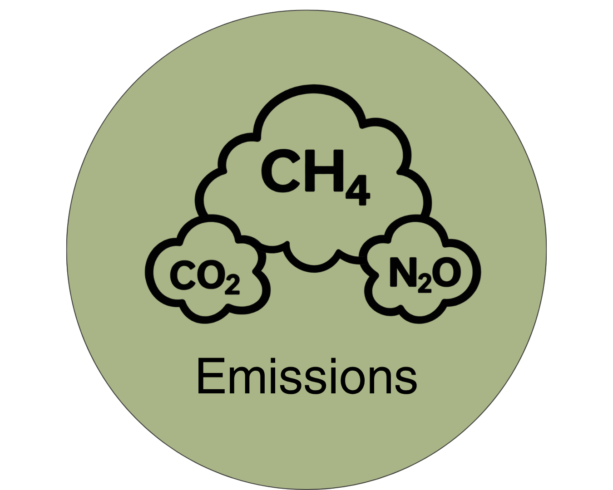

{width=25%}
# Emissions Module
<!-- reuse code to import functions from "../scripts/": -->



## Introduction

Throughout the 4 biophysical modules, emissions are estimated and reported directly from the methods within those modules and thus described within the appropriate sections of this documentation. Some emissions estimates are the results of upstream emissions created during the production of items purchased by the farm or are the result of an aggregation and allocation of emissions from a variety of sources. The methodology for those emissions that are not directly described in the biophysical modules are described in this section. The two relevant emissions methods currently represented in RuFaS are for two distinct methods to estimate emissions associated with the production of feed that is fed to animals:

1. The **Purchased Feed Emissions** methodology assigns an aggregated emissions factor to each purchased feed with an available emissions factor
2. The **Homegrown Feed Emissions** methodology allocates direct emissions from the field as well as fertilizer and manure nutrient applications to each crop harvested, stored, and fed to animals. 

The emissions and resource used associated with feeds are calculated by the `EmissionsEstimator` class in `emissions.py` and reported on a daily basis for each feed based on the amount of each feed fed to the herd that day. 

## Purchased Feed Emissions

### Calculation of Purchased Feed Emissions

Purchased feed emissions are calculated multiplying the emission factor associated with feed $i$ ($\text{EF}_{i}$) by the total dry matter mass of the feed fed to the herd each day ($\text{DM_Fed}_{i}$). 

:::{#eq-em-pfe-1}

[[**EM.PFE.1**]]{.aside .content-visible when-format="html"}    
$$
\text{PurchasedFeedEmission}_{i} = \text{EF}_{i} \times \text{DM_Fed}_{i}
$$
:::

In [EM.PFE.1](#eq-em-pfe-1), the emission factors are expected to be in units of $\text{CO}_{2}\text{-eq} / \text{kg feed DM}$. These emissions factors are provided via a database that contains an emission factor for each RuFaS Feed ID for each US FIPS county code. One set of emissions factors describes the total emissions associated with production of the feed, and the other database separates only the emissions associated with land use change. 


### Purchased Feed Emission Factor Database Preparation

The RuFaS model requires a standardized table of emission factors (EF) for all (or as many as possible) of the feeds available in the feed library. These emission factors are expressed in $\text{kg CO}_\text{2}\text{e}/\text{kg}$ feed Dry Matter (DM). Preparing this table involves consolidating data from national, regional, and county-specific sources into a unified county-level format compatible with RuFaS.

#### Data Sources and Initial Processing

The methodology draws on three distinct levels of data, each requiring specific conversions to reach the target units ($\text{kg CO}_\text{2}\text{e}/\text{kg}$ DM), summarized in @tbl-emis-pfe-sources.

```{python}
#| label: tbl-emis-pfe-sources
#| tbl-cap: Data sources used to construct the purchased feed emission factor database.
import_table(
  "../resources/table_data/emissions/tbl-emis-pfe-sources.csv",
  colalign = ["left", "left", "left", "left", "left"]
)
```

The first data processing step is to convert all emission factors into the common unit of $\text{kg CO}_\text{2}\text{e}/\text{kg}$ DM. Regional emission factors, originally reported on a tonne basis, are first converted to a kilogram basis:

:::{#eq-em-pfe-2}
[[**EM.PFE.2**]]{.aside .content-visible when-format="html"}    
$$
\text{EF}_\text{i}^\text{as fed, kg} = \frac{\text{EF}_\text{i}^\text{as fed, tonne}}{1000}
$$
:::

All as-fed emission factors (FoodS3, Regional, and National) are then converted to a dry matter basis using the feed's percent dry matter:

:::{#eq-em-pfe-3}
[[**EM.PFE.3**]]{.aside .content-visible when-format="html"}    
$$
\text{EF}_\text{i}^\text{DM} = \frac{\text{EF}_\text{i}^\text{as fed}}{\text{DM}_\text{i}}
$$
:::

* EF<sub>i</sub><sup>DM</sup>: emission factor of feed i, expressed on a dry matter basis (kg CO<sub>2</sub>e/kg DM)
* EF<sub>i</sub><sup>as fed</sup>: emission factor of feed i, expressed on an as-fed basis (kg CO<sub>2</sub>e/kg as fed)
* DM<sub>i</sub>: fraction of feed i's fresh mass that is dry matter

The percent dry matter assumptions used for this conversion are given in @tbl-emis-pfe-dm-content.

```{python}
#| label: tbl-emis-pfe-dm-content
#| tbl-cap: Percent dry matter assumptions used to convert as-fed emission factors to a dry matter basis.
import_table(
  "../resources/table_data/emissions/tbl-emis-pfe-dm-content.csv",
  colalign = ["left", "center"]
)
```

#### Feed Emission Factors for the RuFaS Feed Library

The RuFaS feed library contains multiple feeds that are distinct from a ruminant nutrition perspective (e.g., forages of varying maturity or feeds with slightly different compositions) but are not differentiated in the methods used to develop the feed emission factors. Available emission factors are therefore extrapolated to cover as many of the RuFaS feeds as possible. @tbl-emis-pfe-feed-id-xwalk cross-references emission factor feed names with the RuFaS Feed IDs that use that feed's emission factor.

```{python}
#| label: tbl-emis-pfe-feed-id-xwalk
#| tbl-cap: Cross-reference between emission factor feed names and RuFaS Feed IDs.
import_table(
  "../resources/table_data/emissions/tbl-emis-pfe-feed-id-xwalk.csv",
  colalign = ["left", "left"]
)
```

The RuFaS feed library also includes four byproduct mixes that represent average regional byproduct feeding rates, as described in a survey and analysis of byproduct feeding [@deondarza2021]. Emission factors for these mixed feeds are calculated by multiplying each component feed's inclusion rate by its emission factor:

:::{#eq-em-pfe-4}
[[**EM.PFE.4**]]{.aside .content-visible when-format="html"}    
$$
\text{EF}_\text{mix} = \sum_{\text{i}=1}^{n} \text{IncRate}_\text{i} \times \text{EF}_\text{i}
$$
:::

* EF<sub>mix</sub>: emission factor of the byproduct mix (kg CO<sub>2</sub>e/kg DM)
* IncRate<sub>i</sub>: inclusion rate of component feed i in the byproduct mix
* EF<sub>i</sub>: emission factor of component feed i (kg CO<sub>2</sub>e/kg DM)
* n: number of component feeds in the byproduct mix

Because @deondarza2021 defines fewer, broader regions than the analysis that produced the regional feed emission factors, the feed emission factors of the smaller feed emission regions are combined into each of the broader byproduct regions as a weighted average based on the 2020 milk production of the smaller regions:

:::{#eq-em-pfe-5}
[[**EM.PFE.5**]]{.aside .content-visible when-format="html"}    
$$
\text{EF}_\text{byproduct region} = \frac{\sum_\text{r} \text{MilkProd}_\text{r} \times \text{EF}_\text{r}}{\sum_\text{r} \text{MilkProd}_\text{r}}
$$
:::

* EF<sub>byproduct region</sub>: emission factor for the feed, weighted-averaged up to a byproduct region (kg CO<sub>2</sub>e/kg DM)
* MilkProd<sub>r</sub>: 2020 milk production (million lbs) of feed emission region r
* EF<sub>r</sub>: emission factor for the feed in the smaller feed emission region r (kg CO<sub>2</sub>e/kg DM)

The crosswalk between the smaller feed emission regions and the four byproduct regions used by @deondarza2021 is given in @tbl-emis-pfe-byprod-region-xwalk.

```{python}
#| label: tbl-emis-pfe-byprod-region-xwalk
#| tbl-cap: Crosswalk between feed emission regions and byproduct regions, weighted by 2020 milk production.
import_table(
  "../resources/table_data/emissions/tbl-emis-pfe-byprod-region-xwalk.csv",
  colalign = ["left", "right", "left"]
)
```

#### Geographic Extrapolation

To translate the data into a format easily used within RuFaS, the geographically broad data are expanded to the most granular scale used by the model: county-level factors. National and Regional emission factors are extrapolated to the county level using a cross-reference table that links Region $\rightarrow$ State $\rightarrow$ County/FIPS.


## Homegrown Feed Emissions


## References